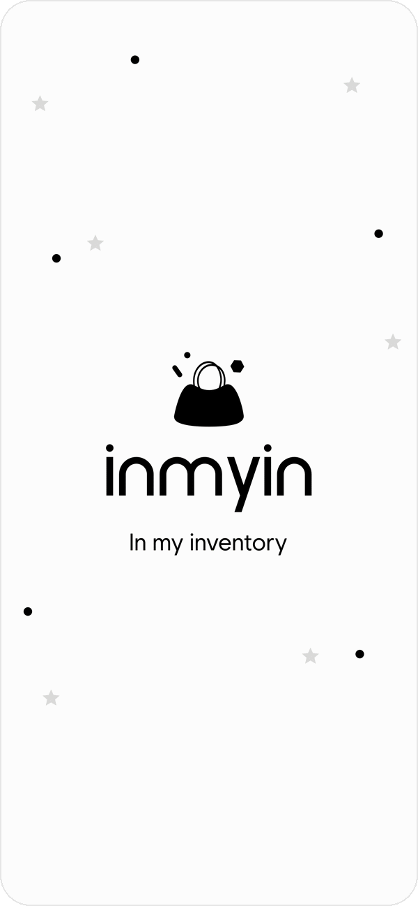
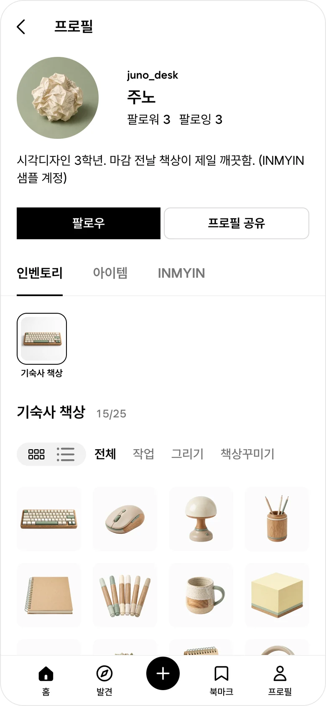
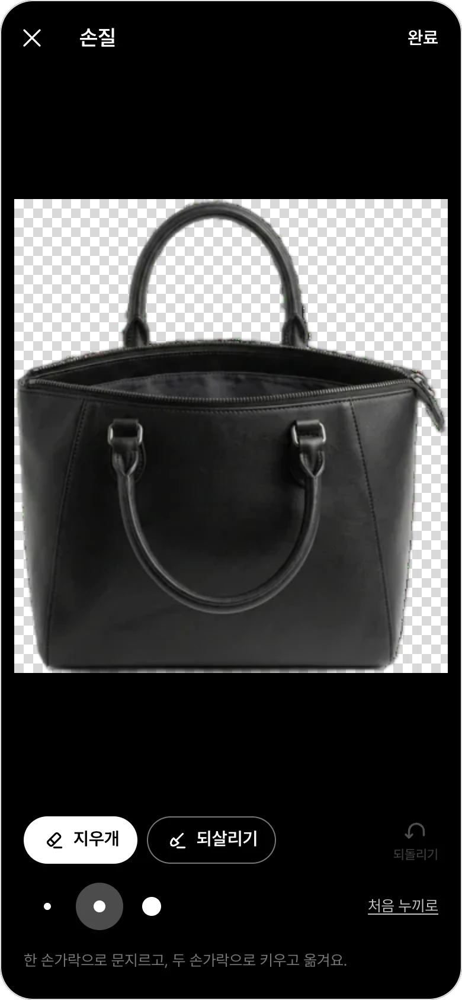
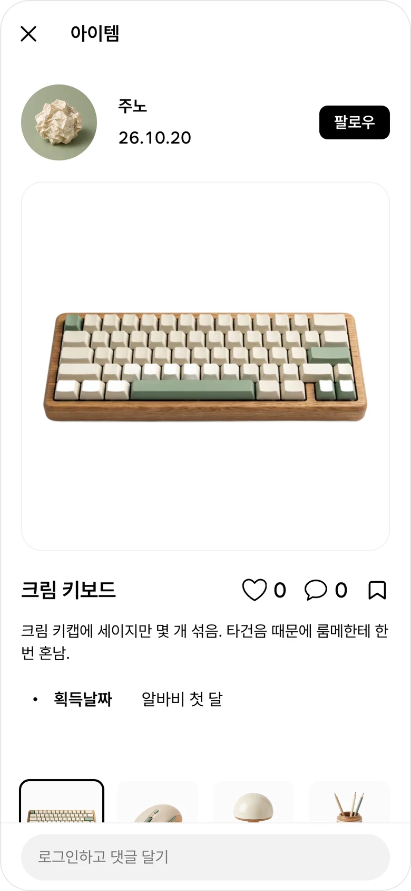
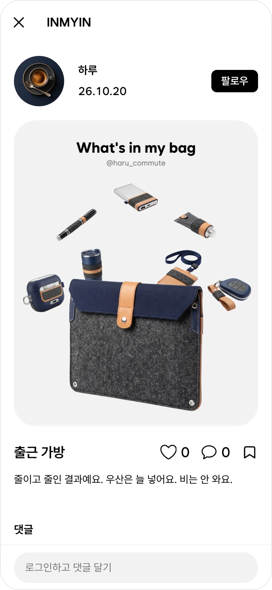
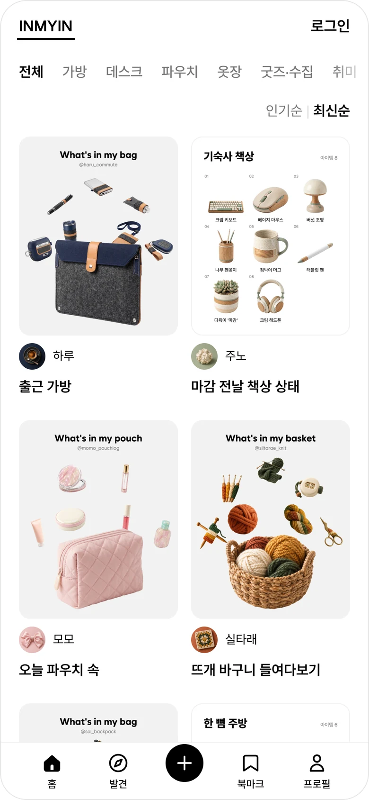
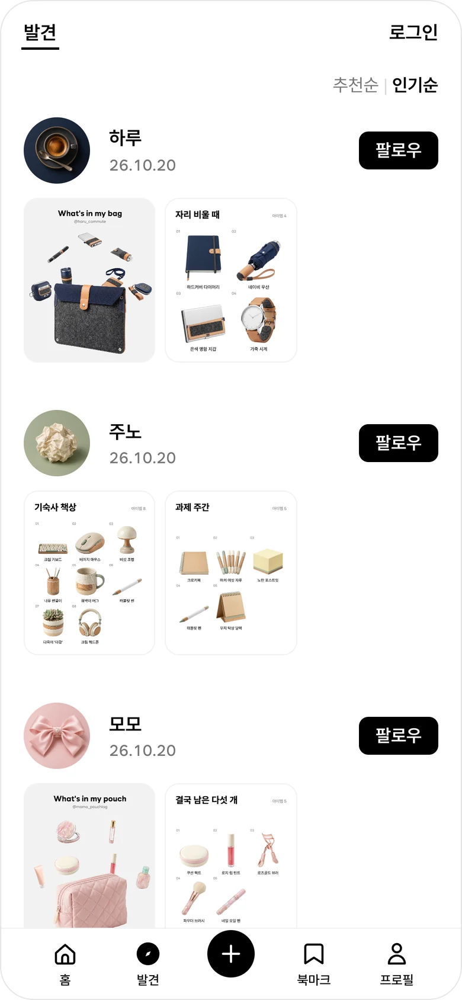
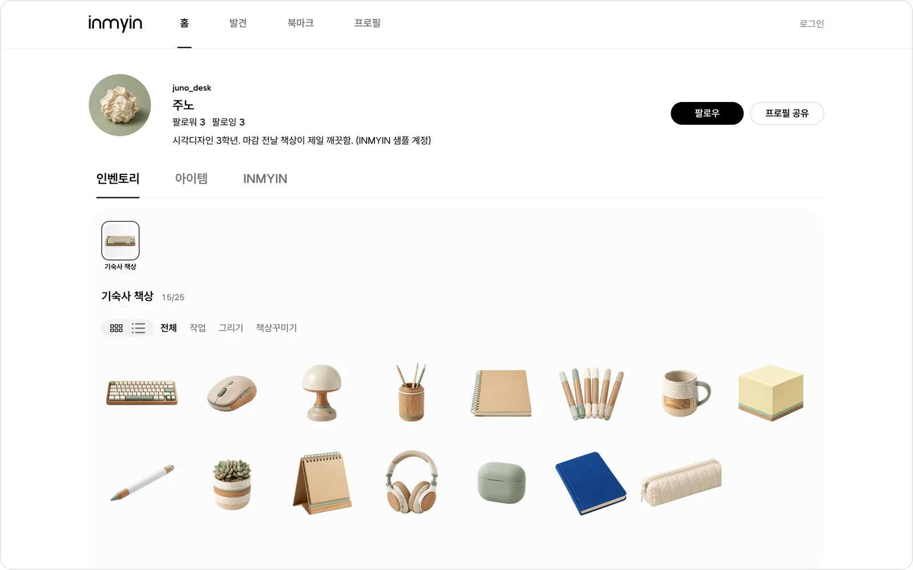
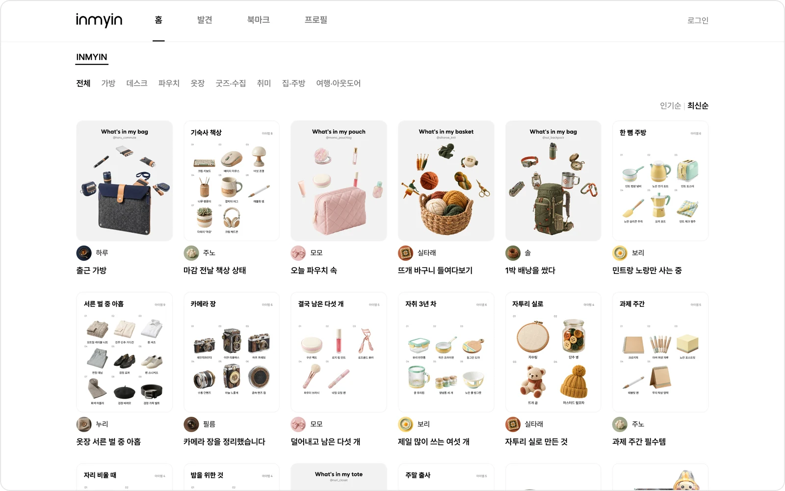

<div align="center">

<picture>
  <source media="(prefers-color-scheme: dark)" srcset="docs/readme/logo-white.svg">
  
</picture>

### In my inventory

**내가 가진 물건을 사진 한 장으로 창고에 넣고, 한눈에 보고, 남에게 보여주는 앱**

[**inmyin.vercel.app 에서 써 보기 →**](https://inmyin.vercel.app)
<br>
<sub>가입 없이도 다른 사람의 인벤토리를 구경할 수 있어요 · 폰 홈 화면에 앱처럼 설치돼요</sub>

<br>



<sub>앱을 열면 — 스플래시가 걷히고, 가방에서 물건이 하나씩 튀어나와 칸에 꽂혀요</sub>

</div>

<br>

## INMYIN 은 이런 앱이에요

게임 속 **인벤토리**처럼, 내 물건을 격자 칸에 하나씩 채워 넣는 앱이에요.

<table>
<tr>
<td align="center" width="33%">

**① 찍는다**

물건 사진을 한 장 찍으면

</td>
<td align="center" width="33%">

**② 칸에 꽂힌다**

배경이 저절로 지워지고<br>물건만 남아 칸에 들어가요

</td>
<td align="center" width="33%">

**③ 보여준다**

모은 물건을 꾸며서 올리고<br>다른 사람의 것도 구경해요

</td>
</tr>
</table>

가방 속, 책상 위, 파우치, 옷장, 냉장고까지 — 정리하고 기록하는 게 즐거운 사람, 내 취향을 보여주고 싶은 사람을 위해 만들었어요.

<br>

## 둘러보기

<table>
<tr>
<td align="center" width="33%">
<br>
<b>내 인벤토리</b><br>
<sub>가진 물건이 칸마다 한눈에.<br>태그로 골라 볼 수 있어요</sub>
</td>
<td align="center" width="33%">
<br>
<b>배경 지우기 · 다듬기</b><br>
<sub>사진의 배경은 자동으로 지워져요.<br>남은 부분은 지우개로 손질</sub>
</td>
<td align="center" width="33%">
<br>
<b>아이템 한 개씩</b><br>
<sub>이름 · 설명 · 획득날짜를 남기고<br>하트 · 댓글 · 북마크</sub>
</td>
</tr>
<tr>
<td align="center" width="33%">
<br>
<b>INMYIN 게시물</b><br>
<sub>"What's in my bag" 처럼<br>물건을 한 장에 꾸며서 올려요</sub>
</td>
<td align="center" width="33%">
<br>
<b>INMYIN 피드</b><br>
<sub>가방 · 데스크 · 파우치 · 옷장…<br>카테고리별로 구경하기</sub>
</td>
<td align="center" width="33%">
<br>
<b>발견</b><br>
<sub>취향이 맞는 사람을 찾고<br>팔로우해요</sub>
</td>
</tr>
</table>

### 큰 화면에서도

컴퓨터에서는 넓은 레이아웃으로 열려요. 기능은 폰과 같고, 사진은 촬영 대신 올리기로 넣어요.





<sub>화면 속 사람과 물건은 모두 샘플 계정이에요. 프로필 소개란에 "INMYIN 샘플 계정"이라고 밝혀 두었어요.</sub>

<br>

## 할 수 있는 것

| 기능 | 설명 |
| --- | --- |
| 📷 **찍으면 바로 정리** | 사진을 찍거나 올리면 배경이 자동으로 지워지고, 물건만 남은 그림이 다음 빈칸에 꽂혀요. 배경 지우기는 내 브라우저 안에서 돌아요 |
| 🗂 **인벤토리 안에 인벤토리** | 집 › 방 › 가방 › 파우치처럼 5겹까지 담을 수 있어요. 이사할 때 상자마다 뭐가 들었는지 적어 두기 좋아요 |
| 🧳 **짐싸기** | 물건을 다른 인벤토리로 옮겨요. 태그도 같이 따라가요 |
| 🏷 **카테고리 · 태그** | 남의 것을 구경할 땐 고정 카테고리 8개로, 내 것을 정리할 땐 자유 태그로 |
| 🎨 **INMYIN 에디터** | 모은 물건을 캔버스에 올리고, 배경과 글자를 넣어 한 장짜리 게시물로 |
| 💬 **보여주기 · 구경하기** | 하트, 북마크, 댓글, 팔로우, 알림. 인기순 · 추천순 발견 |
| 🔒 **공개 · 비공개** | 비공개로 둔 물건과 인벤토리는 남에게 아예 보이지 않아요 (DB 규칙으로 막음) |
| 📱 **앱처럼 설치** | 앱스토어 없이 폰 홈 화면에 추가해서 써요 (PWA) |

로그인은 구글 · 카카오 · 이메일로 할 수 있어요.

<br>

## 폰에 설치하기

| 아이폰 (Safari) | 안드로이드 (Chrome) |
| --- | --- |
| 공유 버튼 › **홈 화면에 추가** | 메뉴 ⋮ › **앱 설치** 또는 **홈 화면에 추가** |

첫 물건을 저장하면 앱 안에서도 설치 방법을 알려 드려요.

<br>

## 만든 재료

| 영역 | 쓴 것 | 하는 일 |
| --- | --- | --- |
| 뼈대 | [Next.js](https://nextjs.org) (App Router) · TypeScript | 화면과 서버 |
| 스타일 | [Tailwind CSS](https://tailwindcss.com) | 색 · 여백 |
| 백엔드 | [Supabase](https://supabase.com) (Auth · Postgres · Storage) | 로그인 · 데이터 · 사진 보관 |
| 배경 지우기 | [`@imgly/background-removal`](https://github.com/imgly/background-removal-js) | 브라우저 안에서 물건만 남기기 |
| 에디터 | [Konva](https://konvajs.org) (`react-konva`) | 캔버스에 올리고 돌리고 키우기 |
| 설치형 앱 | [Serwist](https://serwist.pages.dev) | 홈 화면 설치 · 오프라인 화면 |
| 배포 | [Vercel](https://vercel.com) (서울 리전) | 인터넷에 올리기 |

GraphQL · Prisma · 별도 API 서버 없이, Supabase 에 바로 읽고 써요.

<br>

## 직접 실행해 보기

```bash
cp .env.example .env.local   # Supabase 주소와 키를 채워요 (설명은 파일 안에)
npm install
npm run dev                  # http://localhost:3000
```

```bash
npm test                     # 시험 전체
```

더 알고 싶다면:

- 무엇을 왜 만드는지 — [`docs/PRD.md`](docs/PRD.md)
- 화면 하나하나 — [`docs/screens.md`](docs/screens.md)
- 데이터 구조 — [`docs/data-model.md`](docs/data-model.md)
- 처음이라면 용어 풀이부터 — [`docs/for-beginners.md`](docs/for-beginners.md)
- 개발 규칙 — [`CLAUDE.md`](CLAUDE.md)

<br>

## 라이선스

이 저장소의 소스코드는 **AGPL-3.0** 으로 공개합니다 ([`LICENSE`](LICENSE)).

배경제거에 쓰는 [`@imgly/background-removal`](https://github.com/imgly/background-removal-js) 이 AGPL-3.0 이라, 이 앱을 남에게 서비스로 제공하려면 앱의 소스코드도 같은 조건으로 공개해야 합니다. 그래서 공개합니다. 배경제거를 다른 방식으로 갈아타기 전까지는 이 조건이 유지됩니다.

이 저장소에 들어 있는 INMYIN 의 이름 · 로고 · 아이콘 · 디자인은 코드와 별개이며, 소스코드 라이선스가 그 사용을 허락하는 것은 아닙니다.

<br>

<div align="center">
<sub>Made by <b>Dangnee</b></sub>
</div>
